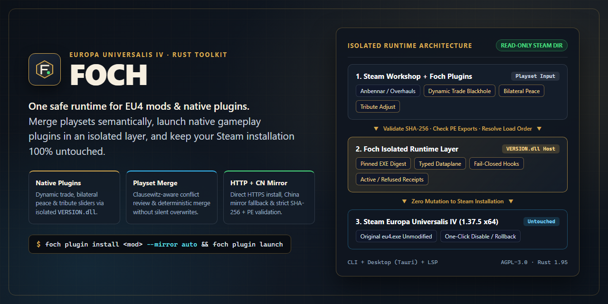

# Foch

**English** | [简体中文](./README.zh-CN.md)

**For EU4 Players:** Foch installs and launches native Europa Universalis IV DLL plugins inside an isolated `VERSION.dll` runtime layer—never modifying Steam's `eu4.exe` or your game directory—with direct HTTPS downloads and built-in China mirror fallback.
**For EU4 Mod Authors & Power Users:** Foch is a Clausewitz-aware toolkit for playset inspection, deterministic semantic merging with explicit conflict review, an editor Language Server (`foch lsp`), and an offline/in-game event test runner (`foch test`).

> [!IMPORTANT]
> **Alpha (`0.0.2`), EU4 only.** Foch passes its focused fixture gates and bounded Workshop probes, and supports Windows x64 EU4 `1.37.5` for native runtime plugins, but it does **not** yet have a complete accepted 14-case Workshop merge cohort. Do not treat it as an unattended one-click merger for arbitrary modlists; always review merge reports before enabling output. See [Honest Current Boundaries & Status](#current-boundary).

---

## Choose Your Path (Quick Start in 30 Seconds)

- [**Path A — Players: Run EU4 Native Plugins Safely**](#path-a--players-run-eu4-native-plugins-safely)
- [**Path B — Modders: Inspect, Check, Merge & Test Playsets**](#path-b--modders-inspect-check-merge--test-playsets)

<a id="install"></a>

### 1. Install `foch`

Download the [latest GitHub Release](https://github.com/Acture/foch/releases/latest), or install `0.0.2` via uv, Cargo, or Homebrew. Every channel installs the same `foch` binary (including `foch plugin`, `foch merge`, `foch test`, and `foch lsp`) for Windows x64, Linux x64, and macOS arm64:

| Channel | Command | Notes |
| --- | --- | --- |
| **GitHub Releases** | [Download latest archive](https://github.com/Acture/foch/releases/latest) | Prebuilt binaries for `win32-x64`, `linux-x64`, `darwin-arm64` |
| **PyPI (via uv)** | `uv tool install foch` *(or `uvx foch <command>`)* | Fast cross-platform binary install |
| **crates.io (Cargo)** | `cargo install foch-cli --locked` | Builds from published workspace crates |
| **Homebrew** (macOS arm64, Linux x64) | `brew install acture/ac/foch` | Official tap |
| **WinGet** (Windows x64) | *Not yet available from the community source* | Use GitHub Release, `uv`, or `cargo` |

All channels report one identity: `foch --version` prints `foch-cli <version>` and the embedded `cwt-schema` ID.

> [!NOTE]
> The crates.io `foch 0.1.0` package is an older, superseded product unrelated to this source line. If you previously installed it, run `cargo uninstall foch` before installing `foch-cli` (both provide a `foch` executable).

---

### Path A — Players: Run EU4 Native Plugins Safely

Foch manages native Windows x64 EU4 DLL plugins per playset and launches EU4 from a disposable short-path **`RuntimeLayer`**. Your Steam installation and source mods remain **100% read-only**.

#### 3-Command Plugin Flow

```sh
# 1. Install a registered plugin ID or any GitHub release (owner/repo[@tag|@latest])
#    Uses HTTPS by default; auto-selects China mirrors on zh-CN locale, or pass --mirror cn / --transport gh
foch plugin install io.github.yozoratempest.eu4-unicode-patch

# 2. Enable the plugin for your playset (pins the highest installed version by default)
foch plugin enable io.github.yozoratempest.eu4-unicode-patch --playset default

# 3. Launch EU4 inside an isolated RuntimeLayer (stages VERSION.dll proxy; never touches Steam eu4.exe)
foch plugin launch --playset default
```

Need to inspect what loaded or check why a plugin refused activation?

```sh
foch plugin list --playset default
foch plugin plan --playset default
foch plugin status --run-dir "<RUNTIME_DIR_PRINTED_BY_LAUNCH>"
```

#### Built-in Plugin Registry & Conflict Detection

Foch ships with built-in legacy adapters and release metadata in [`registry.toml`](./src/packages/foch/src/plugin/registry.toml) so popular upstream EU4 `1.37.5` DLLs work out of the box without needing a custom `foch-plugin.toml`:

| Plugin ID | Upstream Release | Purpose & Built-in Rules |
| --- | --- | --- |
| `io.github.yozoratempest.eu4-unicode-patch` | [`YozoraTempest/EU4-Unicode-Patch`](https://github.com/YozoraTempest/EU4-Unicode-Patch) `0.1.15` | UTF-8 / CJK font & text patch (`entry` phase). Automatically declares `conflicts_with` `eu4dll` because Unicode Patch `v0.1.15` refuses to initialize when `plugin64.dll` is loaded. |
| `io.github.yozoratempest.eu4-menu-patch` | [`YozoraTempest/EU4-Menu-Patch`](https://github.com/YozoraTempest/EU4-Menu-Patch) `0.1.4-experimental` | UI/Menu patch (`deferred` phase, ordered after `eu4-unicode-patch` when both are selected). |
| `io.github.matanki-saito.eu4dll` | [`matanki-saito/EU4dll`](https://github.com/matanki-saito/EU4dll) `93.0.0` (build 93) | Multibyte legacy localization DLL (`plugins/plugin64.dll`), stripping upstream auto-updater scripts/binaries on import. |

You can install any individual entry by its ID or `owner/repo`, or install all registered upstream releases at once with `foch plugin install --all`.

#### Foch Native Plugin Ecosystem

Beyond legacy adapters, Foch provides an ABI-checked native plugin SDK ([`foch-plugin-sdk`](./src/packages/foch-plugin-sdk)), a typed EU4 `1.37.5` data plane ([`foch-runtime`](./src/packages/foch-runtime/README.md)), and an isolated Windows x64 `VERSION.dll` proxy host ([`foch-runtime-host`](./src/packages/foch-runtime-host/README.md)):

- **Dynamic Trade Blackhole** ([`plugins/eu4-dynamic-trade-blackhole`](./plugins/eu4-dynamic-trade-blackhole/README.md) / `Acture/eu4-dynamic-trade-blackhole`): Makes EU4's trade topology dynamic on the monthly economy tick—routes close and reopen along wealth gradients, emergent trade black holes form where purchasing power lives, and transit/producer nodes earn role fees without touching `common/tradenodes`.
- **Standalone Native Gameplay Plugins** (such as **Tribute Adjust** and **Bilateral Peace**): Install directly from GitHub releases via `foch plugin install <owner/repo>` or import locally unpacked packages via `foch plugin import <DIR>`.
- **Directed Pacts** ([`plugins/eu4-directed-pacts`](./plugins/eu4-directed-pacts/README.md)): In-tree pact domain model and read-only war-roster diagnostic probe fixture (`dev.foch.directed-pacts.roster-probe`); its normal gameplay DLL currently refuses activation (`reason 201`) while native war-entry and save-binding bridges are unfinished.

> [!NOTE]
> **Windows Host DLL Requirement:** `foch plugin launch` (and `foch test --with-plugins`) requires the Windows x64 host DLL beside `foch.exe` (`foch_runtime_host.dll` in a source build, or `foch_runtime.dll` from the optional `foch-runtime-host` Windows bundle), or an explicit `--host-dll <DLL>`. See [`src/packages/foch-runtime-host/README.md`](./src/packages/foch-runtime-host/README.md) for host build and bundle verification commands.

#### Security, Verification & China-Network Friendliness

- **No `gh` CLI Required (`--transport auto|http|gh`):** Ordinary installs use direct HTTPS (`reqwest` + `rustls`). `--transport auto` (the default, overridable via `FOCH_PLUGIN_TRANSPORT`) tries HTTPS first and only falls back to `gh` if HTTPS fails and `gh` is on `PATH`. Use `--transport http` to forbid `gh`, or `--transport gh` to force `gh release download`.
- **China Mirror Chain with Direct Fallback (`--mirror auto|cn|direct|URL`):** On a mainland China locale (`zh-CN` / `zh_CN`), `--mirror auto` (overridable via `FOCH_PLUGIN_MIRROR`) automatically tries the curated HTTPS mirror chain (`https://gh-proxy.com/`, `https://ghfast.top/`) before falling back to `https://github.com/`. Force China mirrors anywhere with `--mirror cn`, bypass mirrors with `--mirror direct`, or supply custom HTTPS prefixes / `{url}` templates.
- **Strict Archive & PE Guardrails:**
  - Every downloaded archive is capped at **32 MiB** (`MAX_DOWNLOAD_BYTES`, matching the expanded zip cap).
  - Pass `--sha256 <64-HEX>` to enforce fail-closed digest verification before unpacking.
  - Package import and runtime staging inspect actual **AMD64 PE32+ export tables offline** without loading or executing DLLs: the host DLL must export all 17 `VERSION.dll` symbols at their exact ordinals and must not export `foch_plugin_get_api`, while native plugin DLLs must export `foch_plugin_get_api` and never carry `VERSION.dll` proxy exports.

---

<a id="build-and-try-it"></a>

### Path B — Modders: Inspect, Check, Merge & Test Playsets

Foch understands Clausewitz script, localisation, CSV, JSON, and EU4 database loader semantics. It inspects your Paradox Launcher `dlc_load.json` or declarative `foch.toml` in playset order, surfaces genuine ambiguity instead of silently overwriting one mod's work, and writes merged output to a separate directory.

#### 1. Build Your EU4 Base-Data Snapshot (One-Time Setup)

An installed `foch` binary does not redistribute Paradox game files. Before checking or merging a playset, build and install a base-data snapshot from your local EU4 installation:

```sh
foch data build eu4 \
  --from-game-path "/path/to/Europa Universalis IV" \
  --game-version auto \
  --install
```

#### 2. Inspect, Check & Merge a Playset

```sh
# Inspect resolved game root, playset order, Workshop IDs, and readiness
foch input inspect "/path/to/Paradox Interactive/Europa Universalis IV/dlc_load.json"

# Run semantic & syntax checks (or preview/apply linter-style syntax repairs with --diff / --fix)
foch check "/path/to/Paradox Interactive/Europa Universalis IV/dlc_load.json"

# Analyze and review a deterministic merge plan without writing to --out
foch merge "/path/to/Paradox Interactive/Europa Universalis IV/dlc_load.json" \
  --out ./merged-mod \
  --non-interactive

# Commit the reviewed merge result (interactive TTY confirmation or explicit --confirm)
foch merge "/path/to/Paradox Interactive/Europa Universalis IV/dlc_load.json" \
  --out ./merged-mod \
  --confirm
```

You can also run bare `foch` with no arguments to open an interactive, read-only terminal browser over your current EU4 Launcher playset and its full merge analysis.

#### 3. Read-Only & Non-Silent-Overwrite Conflict Policy

- **Source mods and the EU4 installation are always read-only.** Foch reads Workshop mods in place without copying whole mod trees into an input CAS.
- **Analyze → Review → Confirm → Commit:** `foch merge` freezes input identities, computes the semantic merge, and presents its review without touching `--out`. Only a TTY confirmation or `--confirm` commits output. Replacing a non-empty `--out` directory requires a separate interactive TTY overwrite confirmation (CI/batch jobs with `--confirm --non-interactive` must target a new or empty path).
- **Partial Success Without Silent Loss:** Unresolved files or complete definition modules (`needs_user_choice`, `unsupported_input`, `engine_failure`) are withheld while unrelated safe units are written (`partial_success`). `--force` applies only to supported `needs_user_choice` fallbacks; it never turns unsupported input or engine failures into output.
- **Declarative Conflict Resolutions (`[[resolutions]]`):** Instead of broad silent overrides, record narrow reviewed decisions in `foch.toml` (or export full conflict trees and decision records with `--review-json PATH` and `--review-all`):

```toml
[[resolutions]]
match = "common/ideas/00_country_ideas.txt"
handler = "last_writer"
```

See [`docs/foch-toml-resolutions.md`](./docs/foch-toml-resolutions.md) and [`docs/foch-project-manifest.md`](./docs/foch-project-manifest.md).

#### 4. Comment-Driven Event Tests (`foch test`) & Editor LSP (`foch lsp`)

Write `#test(...)` annotations directly inside EU4 event comments—annotated files remain 100% valid vanilla EU4 script:

```sh
# Collect and validate #test annotations and tests/*.txt declarations without launching EU4
foch test ./my-mod --collect-only

# Interpret planned test cases against Foch's offline script model (with step-by-step trace)
foch test ./my-mod --offline

# Compile test bundles without running (--no-run), or run them in an isolated EU4 1.37.5 session
foch test ./my-mod --no-run --out ./compiled-tests
foch test ./my-mod --out ./test-results --timeout 300
```

For real-time diagnostics, completions, hover documentation, and `#test` annotation assistance in VS Code, Foch includes a built-in language server (`foch lsp`) paired with [`src/apps/vscode-foch`](./src/apps/vscode-foch); see [`docs/lsp-0.1-preview.md`](./docs/lsp-0.1-preview.md) and [`docs/foch-runtime-tests.md`](./docs/foch-runtime-tests.md).

#### 5. Numeric Precision & EU4 `1.37.5` Fixed-Point Fidelity

Where the CWT schema types a field as a number, Foch compares exact decimal values so equivalent spellings (`0.5`, `0.50`, `0.500`) never trigger false conflicts, while real differences (`0.0125` vs `0.012`) are preserved. Merged numbers use the highest precision any contributor wrote at that site. For specific fields verified in EU4 `1.37.5` to truncate after three decimals (such as `discipline`, `add_prestige`, `army_tradition`, `set_variable`, `check_variable`), Foch drops unread trailing digits in merged files (`0.0125` → `0.012`) unless you set `[emit] drop_unread_decimals = false` in `foch.toml`.

---

## CLI Command Surface

Run `foch <command> --help` for authoritative flags and examples.

| Command | Purpose |
| --- | --- |
| `foch` | Open the read-only terminal browser over the current EU4 playset and its full merge analysis. |
| `foch plugin <subcommand>` | Manage native DLL plugins: `list`, `import`, `install` (`--transport auto\|http\|gh`, `--mirror auto\|direct\|cn\|URL`, `--sha256`, `--all`), `enable`, `disable`, `plan`, `launch`, `status`. |
| `foch data <subcommand>` | Build (`foch data build eu4 --from-game-path ... --game-version auto --install`), install, and list EU4 base-data snapshots. |
| `foch input inspect [INPUT_SOURCE]` | Show the game root and ordered mod inputs Foch will use (`--format json` supported without `INPUT_SOURCE`). |
| `foch input repair` | List current-playset Workshop mods that cannot be analyzed and, with `--open`, open their Steam Workshop pages to resubscribe. |
| `foch check [INPUT_SOURCE]` | Parse and semantically validate a playset or mod. Supports linter-style syntax repair previews (`--diff`), fixes (`--fix`, `--unsafe-fixes`, `--patch-mod DIR`, `--in-place`), and backup restore (`--restore BACKUP_DIR`). |
| `foch merge [INPUT_SOURCE] --out <DIR>` | Analyze and review a deterministic semantic merge; commit only after TTY confirmation or `--confirm` (`--non-interactive`, `--review-all`, `--review-json`, `--force`, `--provenance`, `--exclude`). |
| `foch test [PATH]` | Collect, compile (`--no-run`), model (`--offline`), or execute (`--with-plugins`, `--isolate`) comment-based `#test` event tests and `tests/` suites. |
| `foch graph [INPUT_SOURCE] --out <DIR>` | Export call, definition-dependency, module, mod-dependency, and semantic family graphs (`json`, `dot`, `both`). |
| `foch simplify [INPUT_SOURCE] --target <MOD> --out <DIR>` | Write a separate copy of a target mod with base-equivalent definitions removed. |
| `foch cache <subcommand>` | Inspect and maintain persistent caches (`stats`, `list`, `clean`, `clear`, `where`). |
| `foch config <subcommand>` | Show, validate, or set local `steam-path`, `paradox-data-path`, and `game-path`. |
| `foch lsp` | Run the Foch Language Server over stdio for the VS Code extension and LSP clients. |

---

## Architecture & Packages Overview

The root `Cargo.toml` is a virtual Cargo workspace alongside Bun packages for the grammar, desktop UI, and VS Code extension. See [`docs/architecture.md`](./docs/architecture.md) for the full dependency graph and module contracts.

| Package / Directory | Version | Role |
| --- | --- | --- |
| [`src/apps/foch-cli`](./src/apps/foch-cli/README.md) | `0.0.2` | The `foch` CLI executable, TUI analysis browser, conflict reviewer, and test-only merge-quality acceptance harness. |
| [`src/apps/foch-desktop`](./src/apps/foch-desktop/README.md) | `0.0.2` | Tauri + React desktop app linked directly to `foch` for read-only input inspection, merge analysis progress, and paginated unit review. |
| [`src/packages/foch`](./src/packages/foch) | `0.0.2` | Core Rust library: EU4 playset & input resolution, embedded CWT schema engine, semantic index, deterministic merge kernel, and native DLL plugin management (`foch::plugin`). |
| [`src/packages/foch-runtime`](./src/packages/foch-runtime/README.md) | `0.0.2` | Typed EU4 `1.37.5` data plane, offline PE host/plugin export validator, hook prologue planner, and isolated out-of-process game runner (`RuntimeLayer`). |
| [`src/packages/foch-runtime-host`](./src/packages/foch-runtime-host/README.md) | `0.0.2` | Independent Windows x64 `cdylib` (`foch_runtime_host.dll` / `foch_runtime.dll`) implementing the `VERSION.dll` proxy and Foch native plugin host ABI. |
| [`src/packages/foch-plugin-sdk`](./src/packages/foch-plugin-sdk) | `0.0.1` | C-ABI contract (`FochHostApi`, `foch_plugin_get_api`) and shared helpers that native EU4 plugins build against. |
| [`src/packages/foch-test`](./src/packages/foch-test) & [`foch-annotation`](./src/packages/foch-annotation) | `0.0.2` | Comment annotation parser (`#test`, `#skip`, `#ignore`, `#xfail`, `#mark`, `#parametrize`), session planner, test-layer compiler, offline interpreter, and log judge. |
| [`src/packages/foch-lsp`](./src/packages/foch-lsp) & [`src/apps/vscode-foch`](./src/apps/vscode-foch) | `0.0.2` / `0.1.0` | Language Server library linked into `foch lsp` and the companion VS Code extension. |
| [`src/packages/tree-sitter-paradox`](./src/packages/tree-sitter-paradox) | `0.3.0` | Independently versioned Tree-sitter grammar for Paradox Clausewitz script. |
| [`src/tools/eu4-analysis`](./src/tools/eu4-analysis/README.md) & [`src/tools/foch-dev`](./src/tools/foch-dev/README.md) | internal | Offline PE token-table & Ghidra-based EU4 binary analysis (`eu4-analysis`) and workspace verification/packaging tools (`foch-dev`). |

---

<a id="current-boundary"></a>

## Honest Current Boundaries & Status

Foch documents its exact verified capabilities and limits without overclaiming. Before relying on merge output or plugin launches, check these boundaries and the full evidence records in [`docs/project-status.md`](./docs/project-status.md) and [`docs/known-issues.md`](./docs/known-issues.md):

1. **Alpha `0.0.2`, EU4 Only:**
   - Only **Europa Universalis IV** has verified loader, content-family, base-data, and merge behavior (`src/packages/foch/src/game/eu4`). Reusable CWT schema machinery under `src/packages/foch/src/game/schema` is infrastructure, not support for CK3, VIC3, HOI4, or Stellaris.
   - Native runtime DLL plugins and the typed data plane target **EU4 `1.37.5` on Windows x64** (`win32-x64`) exclusively and verify the executable SHA-256 before resolving hooks.
2. **Merge Quality Has No Complete Accepted 14-Case Workshop Cohort Yet:**
   - Foch passes its unit/integration test suite (2,367 workspace tests) and bounded real Workshop probes (such as the 2-mod Ricefarmer merge and 4-mod Chinese localisation + Europa Expanded `partial_success` merge documented in [`docs/project-status.md`](./docs/project-status.md)).
   - However, the fixed **14-case, 26-item Workshop acceptance cohort** (`cargo acceptance`) has **not** yet been accepted end-to-end for the current product, and static checks do not prove in-game playability across arbitrary modlists.
3. **Desktop App Scope (`foch-desktop`):**
   - `foch-desktop` currently implements the read-only **inspect / analyze / review** workflow (`inspect_input`, `start_merge_analysis`, `cancel_merge_analysis`, `get_merge_analysis_summary`, `list_merge_units`, `get_merge_unit`), including in-memory `without_unavailable_mods` recovery.
   - Desktop commit/export, a durable interactive `MergeSession` API, and desktop plugin management UI are **not** implemented in this checkpoint.
4. **Optional Windows Plugin Host (`foch-runtime-host`) & Plugin Verification:**
   - Standard CLI installation channels install `foch` only; they do not bundle `foch_runtime.dll`. To run `foch plugin launch` or `foch test --with-plugins` on Windows x64, build `foch-runtime-host` from source or extract the optional `foch-runtime-host-VERSION-win32-x64.zip` bundle beside `foch.exe`.
   - Loading a DLL in the host or passing PE export validation does not by itself prove in-game gameplay correctness; each plugin reports its own `active` / `refused` / `failed` state. In particular, `eu4-dynamic-trade-blackhole` is verified end-to-end in 800-day real game sessions, whereas `eu4-directed-pacts` refuses normal gameplay activation (`reason 201`) and provides only an offline pact library and a read-only war-roster diagnostic probe.
5. **Known Alpha Issues:**
   - Release `0.0.2` includes `rustls 0.23.40`, which carries moderate advisory [`GHSA-2mjx-qc3c-rqvc`](https://github.com/rustls/rustls/security/advisories/GHSA-2mjx-qc3c-rqvc) for network operations (offline merge/check workflows do not use TLS).
   - See [`docs/known-issues.md`](./docs/known-issues.md) for details on windows-1252 CJK escape byte preservation, case-only path collisions, total-conversion `replace_path` cold-run timings, and Windows TUI notes.

---

<a id="development"></a>

## Build & Development

To build the current development version from source:

```fish
git clone https://github.com/Acture/foch.git
cd foch
git submodule update --init --recursive src/packages/tree-sitter-paradox src/packages/foch/vendor/cwtools-eu4-config
cargo install --path src/apps/foch-cli
```

To also build the Windows x64 native plugin host beside `foch`:

```fish
cargo build --locked -p foch-cli -p foch-runtime-host
```

Workspace quality checks:

```fish
cargo fmt --all --check
cargo clippy --workspace --all-targets --all-features -- -D warnings
cargo test --workspace
bun install --frozen-lockfile
bun run --cwd src/packages/tree-sitter-paradox test
bun run --cwd src/apps/vscode-foch smoke
```

- **Embedded CWT Rules:** EU4 CWT schemas are vendored at `src/packages/foch/vendor/cwtools-eu4-config` and compiled with Foch's supplementary rules in `src/packages/foch/src/game/eu4/cwt_supplement` into the binary at build time.
- **EU4 Database Loading Rules (`eu4-analysis`):** Versioned database-to-directory rules live in [`src/packages/foch/src/game/eu4/content/rules`](./src/packages/foch/src/game/eu4/content/rules), extracted from symbol-bearing x86_64 Mach-O binaries via [`src/tools/eu4-analysis`](./src/tools/eu4-analysis) (`uv run --directory src/tools/eu4-analysis python -m eu4_analysis discover --binary "$EU4_BINARY" --game-version 1.37.5` and `python -m eu4_analysis builtins`). Rule snapshots are embedded at build time; using Foch never requires Python or Ghidra.
- **Repository Maintenance (`foch-dev`):** [`src/tools/foch-dev`](./src/tools/foch-dev/README.md) provides maintainer checks (`check`, `schema-hash`, `smoke`, `compare`, `crate-smoke`, `dist`, `winget`, `release preflight`, and `runtime-host check|bundle`).

---

## Documentation

- [Public Documentation Index](./docs/README.md)
- [Project Status & Verification Evidence](./docs/project-status.md)
- [Architecture & Package Boundaries](./docs/architecture.md)
- [Merge Design & Lifecycle](./docs/merge-design.md)
- [DLL Plugin Runtime & Services](./src/packages/foch-runtime/README.md)
- [Windows DLL Host Deployment](./src/packages/foch-runtime-host/README.md)
- [Inline EU4 Runtime Tests & Runner Contract](./docs/foch-runtime-tests.md)
- [`foch.toml` Project Manifest Reference](./docs/foch-project-manifest.md)
- [Conflict Resolution DSL (`[[resolutions]]`)](./docs/foch-toml-resolutions.md)
- [Mod Authoring Product Design](./docs/foch-authoring-design.md)
- [VS Code / LSP Preview](./docs/lsp-0.1-preview.md)
- [Known Issues](./docs/known-issues.md)
- [Release Checklist](./docs/RELEASE_CHECKLIST.md)

## License

Foch's own code is AGPL-3.0-only ([LICENSE](./LICENSE)). The `foch` library, and every distributed `foch` program, also contains an adaptation of Mergiraf (GPL-3.0-only, [LICENSE-MERGIRAF.txt](./LICENSE-MERGIRAF.txt)) and embeds a rule pack compiled from the CWTools EU4 config (MIT), so both are distributed as `AGPL-3.0-only AND GPL-3.0-only AND MIT`; the own source of `foch-cli` and of its internal libraries `foch-annotation`, `foch-lsp`, `foch-runner` and `foch-test` is AGPL-3.0-only. Each program also statically links Rust crates under their own licenses, given in [THIRD-PARTY-LICENSES.txt](./THIRD-PARTY-LICENSES.txt). See [NOTICE.md](./NOTICE.md).
