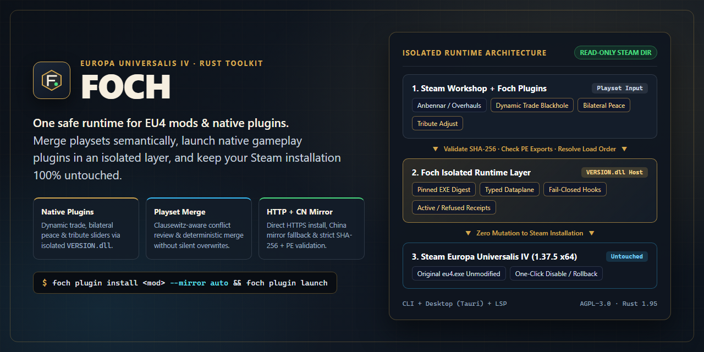

# Foch

[English](./README.md) | **简体中文**

**面向 EU4 玩家：** Foch 在隔离的 `VERSION.dll` 运行层（`RuntimeLayer`）中安装并启动《欧陆风云 IV》（Europa Universalis IV）原生 DLL 插件——绝不修改 Steam 的 `eu4.exe` 或游戏原目录——并内置直连 HTTPS 下载与国内镜像自动回退。
**面向 EU4 Mod 作者与进阶用户：** Foch 是一套理解 Clausewitz 引擎语义的工具链，提供播放集（Playset）检查、带显式冲突审阅的确定性语义合并、编辑器语言服务器（`foch lsp`），以及离线/真机事件测试运行器（`foch test`）。

> [!IMPORTANT]
> **Alpha 开发版（`0.0.2`），仅支持 EU4。** Foch 已通过针对性夹具门禁与受限创意工坊实测，原生运行时插件支持 Windows x64 EU4 `1.37.5`；但当前产品**尚未**完成全部 14 组（26 个 Mod）创意工坊合并验收队列。请勿将其视为任意 Mod 列表的“盲目一键合并器”，启用合并产物前请务必审阅合并报告。详见[当前能力边界与真实状态](#current-boundary)。

---

## 选择你的使用路径（30 秒快速上手）

- [**路径 A — 玩家：安全运行 EU4 原生 DLL 插件**](#path-a)
- [**路径 B — Mod 作者：检查、校验、合并与测试播放集**](#path-b)

<a id="install"></a>

### 1. 安装 `foch`

可从 [GitHub Releases](https://github.com/Acture/foch/releases/latest) 直接下载，或通过 uv、Cargo、Homebrew 安装 `0.0.2`。所有渠道在 Windows x64、Linux x64 和 macOS arm64 上均安装同一个 `foch` 可执行程序（包含 `foch plugin`、`foch merge`、`foch test` 与 `foch lsp`）：

| 安装渠道 | 命令 | 说明 |
| --- | --- | --- |
| **GitHub Releases** | [下载最新发行版压缩包](https://github.com/Acture/foch/releases/latest) | 提供 `win32-x64`、`linux-x64`、`darwin-arm64` 预编译二进制 |
| **PyPI（通过 uv）** | `uv tool install foch` *（或单次运行 `uvx foch <command>`）* | 跨平台快速安装二进制 |
| **crates.io（Cargo）** | `cargo install foch-cli --locked` | 从已发布的工作区 crate 编译安装 |
| **Homebrew**（macOS arm64, Linux x64） | `brew install acture/ac/foch` | 官方 Tap |
| **WinGet**（Windows x64） | *尚未进入社区源* | 请使用 GitHub Release、`uv` 或 `cargo` |

所有渠道均报告统一身份：`foch --version` 会输出 `foch-cli <version>` 以及当前版本内嵌的 `cwt-schema` 规则标识。

> [!NOTE]
> crates.io 上的 `foch 0.1.0` 是早期已废弃的旧产品，与当前代码线无关。若曾安装过该包，请在安装 `foch-cli` 前先运行 `cargo uninstall foch`（两者均提供名为 `foch` 的可执行文件）。

---

<a id="path-a"></a>

### 路径 A — 玩家：安全运行 EU4 原生 DLL 插件

Foch 按播放集（Playset）管理 Windows x64 EU4 原生 DLL 插件，并在一次性短路径运行层（**`RuntimeLayer`**）中启动游戏。你的 Steam 游戏安装目录与源 Mod 始终保持 **100% 只读**。

#### 三步启动原生插件

```sh
# 1. 安装内置注册表插件 ID 或任意 GitHub Release（owner/repo[@tag|@latest]）
#    默认使用 HTTPS；在简体中文环境（zh-CN）自动启用国内镜像链，也可显式指定 --mirror cn 或 --transport gh
foch plugin install io.github.yozoratempest.eu4-unicode-patch

# 2. 在播放集中启用该插件（默认固定为已安装的最高版本）
foch plugin enable io.github.yozoratempest.eu4-unicode-patch --playset default

# 3. 在隔离的 RuntimeLayer 中启动 EU4（自动部署 VERSION.dll 代理宿主，绝不触碰 Steam 原目录的 eu4.exe）
foch plugin launch --playset default
```

需要查看已安装版本、检查加载顺序或排查插件运行状态？

```sh
foch plugin list --playset default
foch plugin plan --playset default
foch plugin status --run-dir "<LAUNCH_输出的运行层目录>"
```

#### 内置插件注册表与冲突自动检测

Foch 在 [`registry.toml`](./src/packages/foch/src/plugin/registry.toml) 中内置了常用上游 EU4 `1.37.5` DLL 的适配器清单与版本元数据，无需上游包自带 `foch-plugin.toml` 即可直接安装与管理：

| 插件 ID | 上游发行版 | 功能与内置规则 |
| --- | --- | --- |
| `io.github.yozoratempest.eu4-unicode-patch` | [`YozoraTempest/EU4-Unicode-Patch`](https://github.com/YozoraTempest/EU4-Unicode-Patch) `0.1.15` | UTF-8 / 双字节汉化字体与文本补丁（`entry` 阶段加载）。内置 `conflicts_with` 规则自动拦截与 `eu4dll` 同开（因 Unicode Patch `v0.1.15` 检测到 `plugin64.dll` 时会拒绝初始化）。 |
| `io.github.yozoratempest.eu4-menu-patch` | [`YozoraTempest/EU4-Menu-Patch`](https://github.com/YozoraTempest/EU4-Menu-Patch) `0.1.4-experimental` | 菜单与 UI 扩展补丁（`deferred` 阶段加载；与 `eu4-unicode-patch` 同开时自动排在其后）。 |
| `io.github.matanki-saito.eu4dll` | [`matanki-saito/EU4dll`](https://github.com/matanki-saito/EU4dll) `93.0.0` (build 93) | 经典多字节汉化 DLL（`plugins/plugin64.dll`），导入时自动剔除上游压缩包中的自动更新器脚本与程序。 |

你可以按插件 ID 或 `owner/repo` 单独安装，也可使用 `foch plugin install --all` 一键安装全部内置注册插件。

#### Foch 原生插件生态

除兼容传统上游 DLL 外，Foch 还提供带 ABI 校验的原生插件 SDK（[`foch-plugin-sdk`](./src/packages/foch-plugin-sdk)）、类型化 EU4 `1.37.5` 数据平面（[`foch-runtime`](./src/packages/foch-runtime/README.md)）以及独立的 Windows x64 `VERSION.dll` 代理宿主（[`foch-runtime-host`](./src/packages/foch-runtime-host/README.md)）：

- **动态贸易黑洞（Dynamic Trade Blackhole）**（[`plugins/eu4-dynamic-trade-blackhole`](./plugins/eu4-dynamic-trade-blackhole/README.md) / `Acture/eu4-dynamic-trade-blackhole`）：在每月经济结算钩子中让 EU4 贸易拓扑动态演化——贸易路线随财富梯度自动关停与重开，高购买力节点自然涌现为“贸易黑洞”，并为中转节点与产地节点发放过路费（transit fee）与产地分成（source bounty），且完全不修改 `common/tradenodes`（与各类贸易 Mod 零冲突）。
- **独立原生玩法插件**（如 **Tribute Adjust** 朝贡调整、**Bilateral Peace** 双边和平等）：可直接通过 `foch plugin install <owner/repo>` 从 GitHub Release 安装，或用 `foch plugin import <DIR>` 导入本地解压包。
- **定向协定（Directed Pacts）**（[`plugins/eu4-directed-pacts`](./plugins/eu4-directed-pacts/README.md)）：仓库内建的定向攻防协定领域库与只读战争名册探测夹具（`dev.foch.directed-pacts.roster-probe`）；由于原生参战桥接与存档绑定尚未接通，其常规玩法 DLL 当前默认拒绝激活（`reason 201`）。

> [!NOTE]
> **Windows 宿主 DLL 说明：** 执行 `foch plugin launch`（及 `foch test --with-plugins`）需要 `foch.exe` 同目录下存在 Windows x64 宿主 DLL（源码编译产物为 `foch_runtime_host.dll`，可选 Windows 宿主包解压后为 `foch_runtime.dll`），或通过 `--host-dll <DLL>` 显式指定。宿主编译与校验命令见 [`src/packages/foch-runtime-host/README.md`](./src/packages/foch-runtime-host/README.md)。

#### 安全校验与国内网络友好设计

- **无需安装 `gh` CLI（`--transport auto|http|gh`）：** 默认下载走内置 HTTPS（`reqwest` + `rustls`）。`--transport auto`（默认，可通过环境变量 `FOCH_PLUGIN_TRANSPORT` 覆盖）优先尝试 HTTPS，仅在 HTTPS 失败且系统 `PATH` 中已存在 `gh` 时才回退至 GitHub CLI。也可通过 `--transport http` 强制纯 HTTPS，或 `--transport gh` 强制使用 `gh release download`。
- **国内镜像链与直连自动回退（`--mirror auto|cn|direct|URL`）：** 在中国大陆语言/时区环境（`zh-CN` / `zh_CN`）下，`--mirror auto`（可通过环境变量 `FOCH_PLUGIN_MIRROR` 覆盖）会自动依次尝试内置 HTTPS 镜像链（`https://gh-proxy.com/`、`https://ghfast.top/`），失败后再回退至 `https://github.com/` 直连。你也可以用 `--mirror cn` 强制优先走国内镜像、用 `--mirror direct` 强制直连 GitHub，或传入自定义 HTTPS 镜像前缀 / `{url}` 模板。
- **严格的压缩包与离线 PE 导出表校验：**
  - 单次下载与解压字节上限严格限制为 **32 MiB**（`MAX_DOWNLOAD_BYTES`）。
  - 支持 `--sha256 <64位十六进制>`，摘要不匹配时立即中止安装（Fail-closed）。
  - 导入与部署阶段在不加载、不执行 DLL 的前提下**离线检查 AMD64 PE32+ 导出表**：宿主 DLL 必须完整保留 `VERSION.dll` 的 17 个导出函数名与序号且不能包含插件入口；原生插件 DLL 必须导出 `foch_plugin_get_api` 且不得夹带 `VERSION.dll` 代理导出。

---

<a id="build-and-try-it"></a>
<a id="path-b"></a>

### 路径 B — Mod 作者：检查、校验、合并与测试播放集

Foch 深度解析 Clausewitz 脚本、本地化（`.yml`）、CSV、JSON 以及 EU4 数据库加载规则。它按播放集顺序读取 Paradox 启动器的 `dlc_load.json` 或声明式 `foch.toml`，保留语义兼容的改动，将真正的结构冲突显式交由用户审阅，并将合并结果写入独立目录。

#### 1. 构建 EU4 基础数据快照（首次运行准备）

已安装的 `foch` 程序不包含任何 Paradox 游戏本体文件。首次执行检查或合并前，请先从你本机的 EU4 安装目录构建并安装基础数据快照（base-data snapshot）：

```sh
foch data build eu4 \
  --from-game-path "/path/to/Europa Universalis IV" \
  --game-version auto \
  --install
```

#### 2. 检查、校验与合并播放集

```sh
# 查看 Foch 解析出的游戏根目录、有序 Mod 列表、创意工坊 ID 与就绪状态
foch input inspect "/path/to/Paradox Interactive/Europa Universalis IV/dlc_load.json"

# 执行语义与语法检查（也可配合 --diff / --fix 像 Linter 一样预览或修复语法错误）
foch check "/path/to/Paradox Interactive/Europa Universalis IV/dlc_load.json"

# 分析并审阅确定性合并结果（--non-interactive 仅分析与展示审阅报告，不写入 --out）
foch merge "/path/to/Paradox Interactive/Europa Universalis IV/dlc_load.json" \
  --out ./merged-mod \
  --non-interactive

# 提交已审阅的合并结果（交互式终端确认或显式传入 --confirm）
foch merge "/path/to/Paradox Interactive/Europa Universalis IV/dlc_load.json" \
  --out ./merged-mod \
  --confirm
```

你也可以直接运行不带参数的 `foch`，在终端中打开只读交互式分析浏览器，直观浏览当前 EU4 启动器播放集及其完整合并分析。

#### 3. 只读输入保障与“绝不静默覆盖”的冲突策略

- **源 Mod 与游戏本体始终只读：** Foch 原地读取已安装的创意工坊 Mod，不会把整个 Mod 目录树复制进输入缓存，也绝不修改源 Mod。
- **分析 → 审阅 → 确认 → 提交：** `foch merge` 先冻结输入身份并计算语义合并结果，在未获确认前不会改动 `--out`。仅当终端交互确认或传入 `--confirm` 时才写入输出目录；若输出目录非空，还需单独的 TTY 覆写确认（因此 CI/批处理使用 `--confirm --non-interactive` 时必须指向新建或空目录）。
- **支持部分成功（`partial_success`），不丢弃安全单元：** 未解决的冲突文件或完整定义模块（`needs_user_choice`、`unsupported_input`、`engine_failure`）会被暂扣，而互不相关的安全单元仍会正常写出（报告为合法的 `partial_success`）。`--force` 仅对受支持的 `needs_user_choice` 启用回退策略，绝不会将不支持的输入或引擎错误强行转为输出。
- **声明式冲突解决方案（`[[resolutions]]`）：** Foch 不会对结构性冲突静默挑选赢家。你可以在 `foch.toml` 中编写精确到文件或冲突 ID 的 `[[resolutions]]` 规则（或使用 `--review-json PATH` 与 `--review-all` 导出完整冲突树与决策点）：

```toml
[[resolutions]]
match = "common/ideas/00_country_ideas.txt"
handler = "last_writer"
```

详见 [`docs/foch-toml-resolutions.md`](./docs/foch-toml-resolutions.md) 与 [`docs/foch-project-manifest.md`](./docs/foch-project-manifest.md)。

#### 4. 注释驱动的事件测试（`foch test`）与编辑器语言服务器（`foch lsp`）

直接在 EU4 事件脚本注释中编写 `#test(...)` 注解——带有测试注解的文件依然是 100% 合法的原版 EU4 脚本：

```sh
# 仅收集并校验 #test 注解与 tests/*.txt 多步骤声明（不启动游戏）
foch test ./my-mod --collect-only

# 使用 Foch 离线脚本模型解释执行测试用例（默认记录逐步执行轨迹）
foch test ./my-mod --offline

# 仅编译生成测试层与清单（--no-run），或启动隔离的真实 EU4 1.37.5 会话执行验证
foch test ./my-mod --no-run --out ./compiled-tests
foch test ./my-mod --out ./test-results --timeout 300
```

在 VS Code 中，`foch lsp` 语言服务器配合 [`src/apps/vscode-foch`](./src/apps/vscode-foch) 插件可提供实时诊断、代码补全、悬停文档与 `#test` 注解辅助；详见 [`docs/lsp-0.1-preview.md`](./docs/lsp-0.1-preview.md) 与 [`docs/foch-runtime-tests.md`](./docs/foch-runtime-tests.md)。

#### 5. 数值精度与 EU4 `1.37.5` 定点数保真

在 CWT 规则声明为数值的字段上，Foch 按精确十进制值比较，因此不同写法（如 `0.5`、`0.50`、`0.500`）不会误报冲突，而真实差异（如 `0.0125` 与 `0.012`）会被严格保留；合并后采用各来源在该位置使用过的最高小数位数写出。对于已在 EU4 `1.37.5` 游戏内实测确认仅保留三位小数的字段（如 `discipline`、`add_prestige`、`army_tradition`、`set_variable`、`check_variable`），Foch 在生成合并文件时会自动舍去游戏不会读取的多余尾数（`0.0125` → `0.012`）。如需在所有位置保留全部数位，可在 `foch.toml` 中设置 `[emit] drop_unread_decimals = false`。

---

## CLI 命令总览

运行 `foch <command> --help` 查看完整参数说明与示例。

| 命令 | 用途 |
| --- | --- |
| `foch` | 打开只读终端交互浏览器，查看当前 EU4 播放集及其完整合并分析（快捷键 `?` 可查看对应 CLI 命令）。 |
| `foch plugin <subcommand>` | 管理原生 DLL 插件：`list`、`import`、`install`（支持 `--transport auto\|http\|gh`、`--mirror auto\|direct\|cn\|URL`、`--sha256`、`--all`）、`enable`、`disable`、`plan`、`launch`、`status`。 |
| `foch data <subcommand>` | 构建（`foch data build eu4 --from-game-path ... --game-version auto --install`）、安装与列出 EU4 基础数据快照。 |
| `foch input inspect [INPUT_SOURCE]` | 显示 Foch 将使用的游戏路径与有序 Mod 输入（不传 `INPUT_SOURCE` 时支持 `--format json`）。 |
| `foch input repair` | 列出当前播放集中无法分析的创意工坊 Mod；配合 `--open` 可在 Steam 中打开对应页面以便重新订阅修复。 |
| `foch check [INPUT_SOURCE]` | 解析并语义检查播放集或 Mod。支持 Linter 风格的语法修复预览（`--diff`）、自动修复（`--fix`、`--unsafe-fixes`、`--patch-mod DIR`、`--in-place`）及备份还原（`--restore BACKUP_DIR`）。 |
| `foch merge [INPUT_SOURCE] --out <DIR>` | 分析并审阅确定性语义合并结果；仅在终端确认或传入 `--confirm` 后提交写出（支持 `--non-interactive`、`--review-all`、`--review-json`、`--force`、`--provenance`、`--exclude`）。 |
| `foch test [PATH]` | 收集、编译（`--no-run`）、离线模拟（`--offline`）或真机运行（`--with-plugins`、`--isolate`）基于 `#test` 注释的事件测试与 `tests/` 测试套件。 |
| `foch graph [INPUT_SOURCE] --out <DIR>` | 导出调用图、定义依赖图、模块划分、Mod 依赖图及内容族语义图（`json`、`dot`、`both`）。 |
| `foch simplify [INPUT_SOURCE] --target <MOD> --out <DIR>` | 将目标 Mod 中与生效基础定义等价的冗余定义剔除，写出到独立目录。 |
| `foch cache <subcommand>` | 查看与维护本地持久化缓存（`stats`、`list`、`clean`、`clear`、`where`）。 |
| `foch config <subcommand>` | 查看、校验或设置本地 `steam-path`、`paradox-data-path` 与 `game-path`。 |
| `foch lsp` | 在 stdio 上启动 Foch 语言服务器，供 VS Code 扩展及各类 LSP 客户端调用。 |

---

## 架构与软件包总览

根目录 `Cargo.toml` 是虚拟 Cargo 工作区，同时配合 Bun 管理语法解析器、桌面前端与 VS Code 扩展。完整依赖方向与模块契约见 [`docs/architecture.md`](./docs/architecture.md)。

| 软件包 / 目录 | 版本 | 职责 |
| --- | --- | --- |
| [`src/apps/foch-cli`](./src/apps/foch-cli/README.md) | `0.0.2` | `foch` 命令行程序、终端只读分析浏览器、交互式冲突审阅器，以及仅用于测试的合并质量验收套件。 |
| [`src/apps/foch-desktop`](./src/apps/foch-desktop/README.md) | `0.0.2` | 直接链接 `foch` 核心库的 Tauri + React 桌面应用，提供输入就绪检查、合并分析进度控制与分页单元审阅。 |
| [`src/packages/foch`](./src/packages/foch) | `0.0.2` | 核心 Rust 库：EU4 播放集与输入解析、内嵌 CWT 规则引擎、跨 Mod 语义索引、确定性合并内核，以及原生 DLL 插件管理（`foch::plugin`）。 |
| [`src/packages/foch-runtime`](./src/packages/foch-runtime/README.md) | `0.0.2` | 类型化 EU4 `1.37.5` 数据平面、离线 PE 宿主/插件导出表校验器、钩子序言规划器，以及隔离的进程外游戏运行器（`RuntimeLayer`）。 |
| [`src/packages/foch-runtime-host`](./src/packages/foch-runtime-host/README.md) | `0.0.2` | 独立的 Windows x64 `cdylib`（`foch_runtime_host.dll` / `foch_runtime.dll`），实现 `VERSION.dll` 代理转发与 Foch 原生插件宿主 ABI。 |
| [`src/packages/foch-plugin-sdk`](./src/packages/foch-plugin-sdk) | `0.0.1` | 原生 EU4 插件构建所依赖的 C-ABI 契约（`FochHostApi`、`foch_plugin_get_api`）与共享辅助类型。 |
| [`src/packages/foch-test`](./src/packages/foch-test) 与 [`foch-annotation`](./src/packages/foch-annotation) | `0.0.2` | 注释注解解析器（`#test`、`#skip`、`#ignore`、`#xfail`、`#mark`、`#parametrize`）、测试局规划器、测试层编译器、离线解释器与日志判定器。 |
| [`src/packages/foch-lsp`](./src/packages/foch-lsp) 与 [`src/apps/vscode-foch`](./src/apps/vscode-foch) | `0.0.2` / `0.1.0` | 链接进 `foch lsp` 的语言服务器库及其配套 VS Code 扩展。 |
| [`src/packages/tree-sitter-paradox`](./src/packages/tree-sitter-paradox) | `0.3.0` | 独立版本化的 Paradox Clausewitz 脚本 Tree-sitter 语法包。 |
| [`src/tools/eu4-analysis`](./src/tools/eu4-analysis/README.md) 与 [`src/tools/foch-dev`](./src/tools/foch-dev/README.md) | 内部工具 | 离线 PE Token 表与 Ghidra EU4 可执行文件分析工具（`eu4-analysis`）与仓库维护/打包校验工具（`foch-dev`）。 |

---

<a id="current-boundary"></a>

## 当前能力边界与真实状态

Foch 严格区分“已验证的能力”与“尚未建立的保证”，绝不夸大宣传。在依赖合并输出或运行插件前，请了解以下边界，并参阅 [`docs/project-status.md`](./docs/project-status.md) 与 [`docs/known-issues.md`](./docs/known-issues.md) 中的完整实测记录：

1. **Alpha `0.0.2`，仅支持 EU4：**
   - 目前仅有 **《欧陆风云 IV》（EU4）** 具备经核验的加载器语义、内容族规则、基础数据快照与合并行为（`src/packages/foch/src/game/eu4`）。`src/packages/foch/src/game/schema` 下的通用 CWT 规则设施仅为基础架构，不代表已支持 CK3、VIC3、HOI4 或 Stellaris。
   - 原生运行时 DLL 插件与类型化数据平面严格绑定 **Windows x64 平台的 EU4 `1.37.5`**（`win32-x64`），并在解析钩子前校验游戏可执行文件 SHA-256。
2. **合并质量尚未完成全部 14 组创意工坊验收队列：**
   - Foch 已通过全部工作区单元与集成测试（2,367 项测试）以及受限的真实创意工坊合并实测（例如 [`docs/project-status.md`](./docs/project-status.md) 记录的 2-Mod Ricefarmer 无冲突合并与 4-Mod 汉化 + Europa Expanded `partial_success` 合并）。
   - 但固定的 **14 组用例、26 个独立创意工坊项目的完整验收队列**（`cargo acceptance`）尚未在当前版本完成全量通过，静态检查通过也不等同于任意 Mod 列表在游戏内可直接游玩。
3. **桌面端应用当前范围（`foch-desktop`）：**
   - `foch-desktop` 当前仅实现了只读的 **检查 / 分析 / 审阅** 工作流（`inspect_input`、`start_merge_analysis`、`cancel_merge_analysis`、`get_merge_analysis_summary`、`list_merge_units`、`get_merge_unit`），支持在缺失个别工坊项时进行纯内存的 `without_unavailable_mods` 降级分析。
   - 桌面端提交/导出（commit/export）、持久化交互式 `MergeSession` API 以及桌面端插件管理界面在当前检查点**尚未实现**。
4. **可选的 Windows 插件宿主（`foch-runtime-host`）与插件验证边界：**
   - 常规 CLI 安装渠道仅安装 `foch`，默认不附带 `foch_runtime.dll`。在 Windows x64 上运行 `foch plugin launch` 或 `foch test --with-plugins` 时，需从源码编译 `foch-runtime-host` 或将可选的 `foch-runtime-host-VERSION-win32-x64.zip` 解压至 `foch.exe` 同目录。
   - 宿主成功加载 DLL 或通过离线 PE 导出表检查，并不自动证明插件在游戏内的玩法逻辑无误；每个插件会独立汇报 `active`、`refused` 或 `failed` 状态。其中 `eu4-dynamic-trade-blackhole` 已通过真实游戏 800 天端到端会话验证，而 `eu4-directed-pacts` 目前默认拒绝常规玩法激活（`reason 201`），仅提供离线协定库与只读战争名册探测夹具。
5. **已知 Alpha 限制：**
   - `0.0.2` 发行版包含 `rustls 0.23.40`，涉及中等严重度安全通告 [`GHSA-2mjx-qc3c-rqvc`](https://github.com/rustls/rustls/security/advisories/GHSA-2mjx-qc3c-rqvc)（仅影响网络操作，离线检查与合并流程不使用 TLS）。
   - 关于 windows-1252 双字节汉化转义字节保留、仅大小写不同的路径冲突、大型全盘转换 Mod（`replace_path`）冷启动耗时以及 Windows 终端 TUI 的注意事项，请参阅 [`docs/known-issues.md`](./docs/known-issues.md)。

---

<a id="development"></a>

## 从源码构建与开发

从源码构建当前开发版本：

```fish
git clone https://github.com/Acture/foch.git
cd foch
git submodule update --init --recursive src/packages/tree-sitter-paradox src/packages/foch/vendor/cwtools-eu4-config
cargo install --path src/apps/foch-cli
```

在 Windows x64 上同时编译原生插件宿主 DLL（生成于 `foch.exe` 同目录）：

```fish
cargo build --locked -p foch-cli -p foch-runtime-host
```

工作区质量检查命令：

```fish
cargo fmt --all --check
cargo clippy --workspace --all-targets --all-features -- -D warnings
cargo test --workspace
bun install --frozen-lockfile
bun run --cwd src/packages/tree-sitter-paradox test
bun run --cwd src/apps/vscode-foch smoke
```

- **内嵌 CWT 规则包：** EU4 CWT 规则子模块位于 `src/packages/foch/vendor/cwtools-eu4-config`，构建时会连同 `src/packages/foch/src/game/eu4/cwt_supplement` 中的补充规则一并编译进二进制文件中。
- **EU4 数据库加载规则（`eu4-analysis`）：** 版本化的“数据库 → 目录与文件模式”规则存放在 [`src/packages/foch/src/game/eu4/content/rules`](./src/packages/foch/src/game/eu4/content/rules)，由 [`src/tools/eu4-analysis`](./src/tools/eu4-analysis) 从带符号表的 x86_64 Mach-O 可执行文件中提取（`uv run --directory src/tools/eu4-analysis python -m eu4_analysis discover --binary "$EU4_BINARY" --game-version 1.37.5` 及 `python -m eu4_analysis builtins`）。规则快照在构建期嵌入 Foch 库，普通用户运行 Foch 无需安装 Python 或 Ghidra。
- **仓库维护工具（`foch-dev`）：** [`src/tools/foch-dev`](./src/tools/foch-dev/README.md) 提供维护者诊断与发布预检命令（`check`、`schema-hash`、`smoke`、`compare`、`crate-smoke`、`dist`、`winget`、`release preflight` 以及 `runtime-host check|bundle`）。

---

## 文档导航

- [公开文档索引](./docs/README.md)
- [项目状态与实测证据记录](./docs/project-status.md)
- [架构设计与包边界](./docs/architecture.md)
- [合并契约与生命周期](./docs/merge-design.md)
- [DLL 插件运行时与数据平面服务](./src/packages/foch-runtime/README.md)
- [Windows DLL 宿主部署与打包校验](./src/packages/foch-runtime-host/README.md)
- [同文件 EU4 事件测试与内置运行器契约](./docs/foch-runtime-tests.md)
- [`foch.toml` 项目清单参考](./docs/foch-project-manifest.md)
- [冲突解决 DSL 参考（`[[resolutions]]`）](./docs/foch-toml-resolutions.md)
- [Mod 作者工具链产品设计](./docs/foch-authoring-design.md)
- [VS Code / LSP 预览说明](./docs/lsp-0.1-preview.md)
- [已知问题与变通方案](./docs/known-issues.md)
- [发布检查清单](./docs/RELEASE_CHECKLIST.md)

## 许可证（License）

Foch 自身代码采用 AGPL-3.0-only 许可（[LICENSE](./LICENSE)）。`foch` 核心库以及所有分发的 `foch` 程序还包含改编自 Mergiraf 的代码（GPL-3.0-only，[LICENSE-MERGIRAF.txt](./LICENSE-MERGIRAF.txt)）并内嵌了由 CWTools EU4 配置编译而成的规则包（MIT），因此两者按 `AGPL-3.0-only AND GPL-3.0-only AND MIT` 组合许可分发；`foch-cli` 及其内部库 `foch-annotation`、`foch-lsp`、`foch-runner` 与 `foch-test` 的自身源码为 AGPL-3.0-only。各程序静态链接的第三方 Rust crate 遵循其各自许可证，详见 [THIRD-PARTY-LICENSES.txt](./THIRD-PARTY-LICENSES.txt) 与 [NOTICE.md](./NOTICE.md)。
