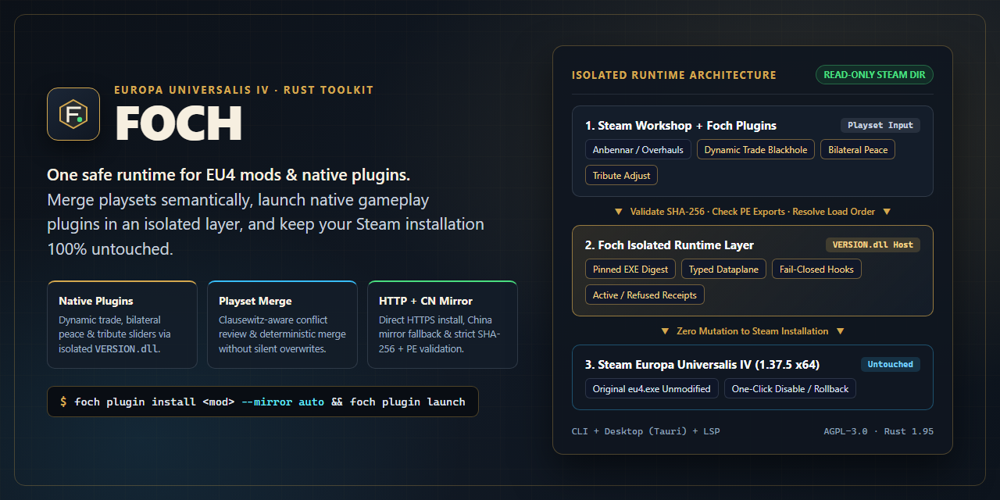

# Foch Desktop

Player-facing Tauri + React desktop application for Foch's EU4 native DLL plugin management, isolated `RuntimeLayer` launching, and read-only playset merge inspection and review.

The Rust backend links the workspace `foch` and `foch-runtime` libraries directly. It must not spawn or bundle the `foch` CLI executable, read merge-quality JSONL as a product API, or add arbitrary filesystem or shell capabilities without a task-specific requirement.

## 4-Tab Bilingual Interface (`简体中文` / `English`)

The frontend provides a 4-tab bilingual interface (`简体中文` and `English`, auto-detected from system locale or switched live via `ui-settings.toml`):

1. **`Play & Launch` (`启动与运行`, default tab):**
   - Displays EU4 `1.37.5` version readiness and Windows x64 host DLL (`foch_runtime_host.dll` / `foch_runtime.dll`) availability.
   - Surfaces companion plugin warnings when enabled playset mods declare required or recommended native plugins in `foch.toml` (`[[plugins]]`) that are not yet installed or enabled, with one-click install actions.
   - Previews the resolved plugin load order and any active dependency or `conflicts_with` errors.
   - Runs **Prepare Only (Dry-Run)** (staging the disposable `RuntimeLayer` and `foch-runtime-plan.json` without starting the game) or **Launch EU4** (with an explicit confirmation dialog) and inspects per-plugin runtime activation states (`active`, `refused`, `failed`, `not_loaded`).
2. **`Plugins` (`插件`):**
   - Lists installed store packages, built-in registry adapters (`registry.toml`), and companion plugins declared by playset mods (`foch.toml` `[[plugins]]`).
   - Installs plugins by registry ID or GitHub release spec (`owner/repo` or `owner/repo@tag`) with optional SHA-256 digest enforcement, or imports an unpacked local package directory.
   - Toggles per-playset plugin activation and renders schema-driven `[config.*]` controls (`bool` checkboxes, bounded `int` range sliders / numeric inputs, and `string` inputs) persisted in `selections.toml`.
3. **`Merge & Conflicts` (`合并与冲突`, APP-003):**
   - Preserves the complete read-only APP-003 inspect/analyze/review workflow: detected load-order readiness rail, analysis progress and cancellation controls, disposition summary ribbon, searchable/filterable paginated unit browser, and unit contributor detail pane.
   - If individual Steam Workshop items are unavailable locally, inspection offers an explicit in-memory `without_unavailable_mods` recovery analysis without editing `dlc_load.json`, Launcher descriptors, or Steam data.
4. **`Settings` (`设置`):**
   - Edits and persists shared CLI / TUI / Desktop preferences in `ui-settings.toml`: download `transport` (`auto` [HTTPS → `gh`], `http`, `gh`), `mirror` (`auto` [China → Direct], `cn`, `direct`, `custom` HTTPS prefixes), and UI `language` (`auto`, `zh_cn` [`简体中文`], `en` [`English`]).

## Tauri Backend Command Surface (15 Commands)

The Tauri `invoke_handler` exposes 15 typed commands across two domain groups:

### Merge Inspection, Analysis & Review (6 APP-003 commands)

- `inspect_input`
- `start_merge_analysis`
- `cancel_merge_analysis`
- `get_merge_analysis_summary`
- `list_merge_units`
- `get_merge_unit`

Only one merge analysis may be queued or running at a time. Terminal analyses are bounded, and unit lists are filtered and paginated in Rust before crossing IPC. `AnalyzedMerge`, raw reports, syntax trees, and generated artifact bytes stay in Rust.

### Native Plugins, Isolated Launch & Shared Settings (9 commands)

- `get_plugin_overview`
- `install_plugin`
- `import_plugin_dir`
- `set_plugin_enabled`
- `update_plugin_config`
- `launch_eu4_with_plugins`
- `get_launch_status`
- `get_desktop_settings`
- `save_desktop_settings`

## Current Honest Boundaries

- **No Desktop Merge Commit/Export Yet:** The `Merge & Conflicts` tab is strictly read-only. Desktop merge commit/export and a durable interactive `MergeSession` API remain deferred.
- **Unpublished Desktop Bundle & Windows x64 Host Requirement:** `foch-desktop` is run from source and is not yet distributed in the standard CLI release channels. Preparing a runtime plan works cross-platform in tests, while launching `eu4.exe` (`launch_eu4_with_plugins` with `prepare_only = false`) requires Windows x64 (`win32-x64`), EU4 `1.37.5`, and `foch-runtime-host` (`foch_runtime_host.dll` or `foch_runtime.dll`).

## Commands

Run from the repository root:

```fish
bun install --frozen-lockfile
bun run --cwd src/apps/foch-desktop format:check
bun run --cwd src/apps/foch-desktop lint
bun run --cwd src/apps/foch-desktop typecheck
bun run --cwd src/apps/foch-desktop test
bun run --cwd src/apps/foch-desktop build
cargo test -p foch-desktop
```

Start the development application with:

```fish
bun run --cwd src/apps/foch-desktop tauri dev
```
